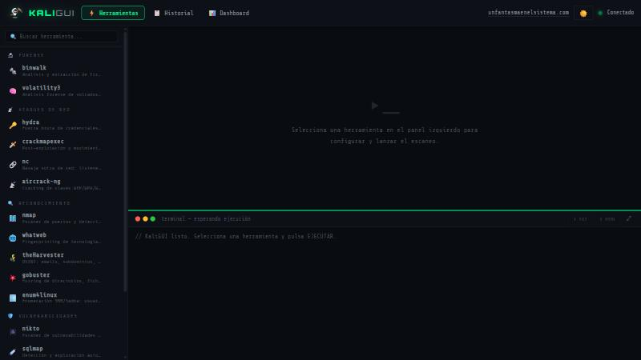
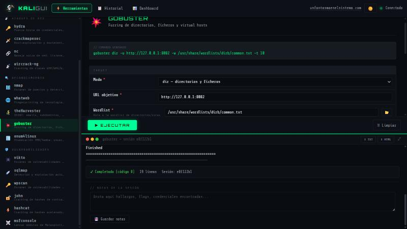
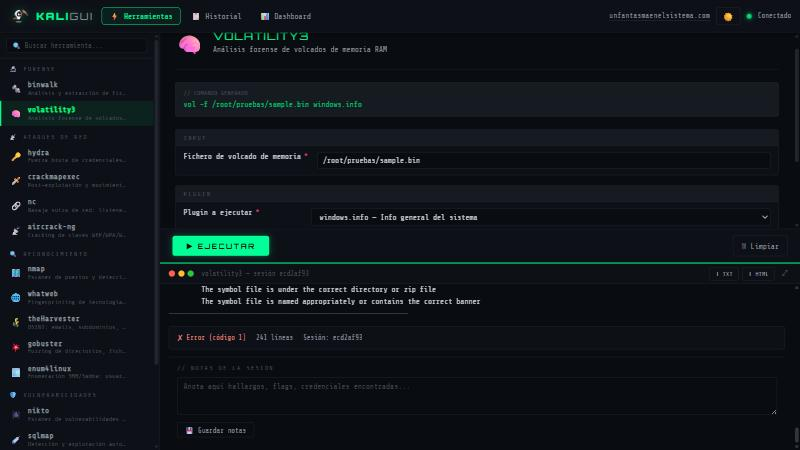
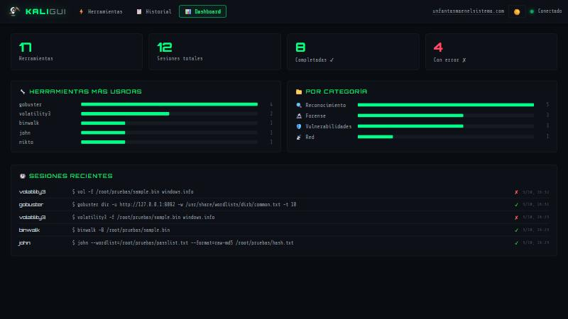

<div align="center">
  

  # KaliGUI 👻
  ### Interfaz web local para las herramientas de Kali Linux

  <p align="center">
    <b>Lanza 17 herramientas de línea de comandos de Kali desde formularios, con la vista previa del comando exacto, salida en tiempo real, chuletas de CTF e historial exportable. Pensada para practicar CTF con máquinas virtuales en VirtualBox o Docker.</b>
  </p>

  <p align="center">
    
    
    
    
    <a href="LICENSE"></a>
  </p>

  <p align="center">
    <strong>Desarrollado por <a href="https://www.unfantasmaenelsistema.com/">Un Fantasma en el Sistema</a></strong>
  </p>
</div>

---

> [!WARNING]
> KaliGUI ejecuta las **mismas herramientas reales** que la terminal de Kali (`nmap`, `sqlmap`, `hydra`, `msfconsole`...). Úsala solo contra máquinas de laboratorio propias, plataformas de CTF o sistemas con autorización expresa por escrito. Escucha en todas las interfaces de red y por eso **exige usuario y contraseña**: no compartas la contraseña ni dejes el puerto 5000 accesible desde redes que no controlas.

---

## 📑 Tabla de Contenidos

1. [Acerca del Proyecto](#-acerca-del-proyecto)
2. [Capturas](#-capturas)
3. [Herramientas Incluidas (17)](#-herramientas-incluidas-17)
4. [Funcionalidades](#-funcionalidades)
5. [Instalación](#-instalación)
6. [Autenticación](#-autenticación)
7. [Acceso desde VirtualBox / Docker](#-acceso-desde-virtualbox--docker)
8. [Añadir una Herramienta Nueva](#-añadir-una-herramienta-nueva)
9. [Estructura del Proyecto](#-estructura-del-proyecto)
10. [Tecnologías Utilizadas](#-tecnologías-utilizadas)
11. [Changelog](#-changelog)
12. [Créditos y Licencia](#-créditos-y-licencia)

---

## 🎯 Acerca del Proyecto

**KaliGUI** es una interfaz web local que sirve de puente hacia la terminal de Kali Linux, no de sustituto: cada formulario muestra el **comando exacto** que va a ejecutar antes de lanzarlo, de modo que rellenar el formulario y leer el comando resultante ayuda a interiorizar la sintaxis de cada herramienta.

Está pensada para las primeras máquinas de CTF y para prácticas de clase: el alumno puede empezar a resolver retos desde el primer día sin quedarse atascado en la sintaxis, y pasar a la terminal en cuanto los comandos le resulten familiares.

---

## 📸 Capturas

| | |
|---|---|
|  |  |
|  |  |

---

## 🧰 Herramientas Incluidas (17)

### 🔍 Reconocimiento
| Herramienta | Descripción |
| :--- | :--- |
| `nmap` | Escáner de puertos y detección de servicios/OS |
| `whatweb` | Fingerprinting de tecnologías web |
| `theHarvester` | OSINT: emails, subdominios, IPs |
| `gobuster` | Fuzzing de directorios, ficheros y subdominios |
| `enum4linux` | Enumeración SMB/Samba completa |

### 🛡️ Vulnerabilidades
| Herramienta | Descripción |
| :--- | :--- |
| `nikto` | Escáner de vulnerabilidades web |
| `sqlmap` | Detección y explotación de SQL injection |
| `wpscan` | Escáner específico para WordPress |
| `john` | Cracking de hashes (John the Ripper) |
| `hashcat` | Cracking acelerado por GPU |
| `msfconsole` | Módulos de Metasploit Framework |

### 📡 Ataques de Red
| Herramienta | Descripción |
| :--- | :--- |
| `hydra` | Fuerza bruta de credenciales |
| `crackmapexec` | Post-explotación en redes Windows/AD |
| `nc` | Netcat: listeners, shells inversas, port scan |
| `aircrack-ng` | Cracking de claves WEP/WPA/WPA2 |

### 🔬 Forense
| Herramienta | Descripción |
| :--- | :--- |
| `binwalk` | Análisis y extracción de firmwares |
| `volatility3` | Análisis forense de volcados de memoria RAM |

---

## ✨ Funcionalidades

| Función | Descripción |
| :--- | :--- |
| **👁️ Preview del comando** | Muestra el comando exacto que se va a ejecutar antes de lanzarlo |
| **🖥️ Terminal en tiempo real** | Salida línea a línea vía WebSockets con coloreado automático |
| **📖 Cheatsheet por herramienta** | 52 ejemplos reales de CTF; un clic rellena el formulario |
| **📚 Wordlist browser** | Explorador de `/usr/share/wordlists` y SecLists integrado en el formulario |
| **✅ Validación de campos** | Doble capa (frontend + backend) antes de ejecutar |
| **🗂️ Historial de sesiones** | Todas las ejecuciones guardadas en JSON con el comando completo |
| **📤 Exportar resultados** | TXT plano o HTML con formato, desde el terminal o el historial |
| **📊 Dashboard** | Estadísticas de uso, herramientas más usadas y sesiones recientes en orden cronológico |
| **🌓 Modo claro/oscuro** | Con persistencia en `localStorage` |

---

## 🚀 Instalación

### Instalación rápida (recomendada)

Dentro de Kali Linux:

```bash
git clone https://github.com/unfantasmaenelsistema/KaliGUI.git
cd KaliGUI
chmod +x install.sh
./install.sh
```

El instalador va en 6 pasos:

1. Verifica el sistema.
2. Actualiza `apt` e instala las dependencias base.
3. Crea el entorno virtual de Python e instala las dependencias (`requirements.txt`).
4. Comprueba las 17 herramientas y **ofrece instalar** las que falten (vía `apt`, o `pip` para `volatility3` y `crackmapexec`), preguntando antes.
5. Comprueba las wordlists y descomprime `rockyou.txt` si hace falta.
6. Genera la contraseña de acceso (ver [Autenticación](#-autenticación)).

Al terminar crea `start.sh` y, si existe la carpeta de escritorio, un acceso directo.

### Arrancar

```bash
./start.sh
```

Abre `http://localhost:5000` desde el propio Kali, o `http://<IP-de-Kali>:5000` desde el anfitrión (ver [Acceso desde VirtualBox / Docker](#-acceso-desde-virtualbox--docker)).

### Instalación manual

```bash
python3 -m venv venv
source venv/bin/activate
pip install -r requirements.txt
python3 app.py
```

En este caso, si no existe `.kaligui_auth`, la contraseña se genera en el primer arranque y se muestra en la consola.

---

## 🔐 Autenticación

KaliGUI escucha en todas las interfaces de red (`0.0.0.0:5000`), necesario para acceder desde el anfitrión vía reenvío de puertos de VirtualBox, así que **pide usuario y contraseña** antes de dejar lanzar ninguna herramienta. Sin esto, cualquiera que llegara al puerto podría ejecutar `nmap`/`sqlmap`/`hydra`/`msfconsole` contra cualquier objetivo.

- `install.sh` genera la contraseña automáticamente (paso `[6/6]`) y la muestra al final de la instalación.
- Se guarda en el fichero local `.kaligui_auth` (permisos `600`, nunca se sube a git). Si lo pierdes, bórralo y reinicia KaliGUI: se genera uno nuevo.
- Usuario: `kaligui` — Contraseña: la que te haya mostrado la instalación (o el primer arranque, si no pasaste por `install.sh`).
- El navegador pide las credenciales la primera vez que accedes a cada origen (`localhost:5000`, `<IP>:5000`...) y las recuerda mientras la sesión del navegador siga abierta.

---

## 🖧 Acceso desde VirtualBox / Docker

| Escenario | URL |
| :--- | :--- |
| Navegador dentro de Kali | `http://127.0.0.1:5000` |
| Desde el host (port forwarding) | `http://localhost:5000` |
| Desde el host (IP directa) | `http://192.168.X.X:5000` |
| Máquina víctima en Docker | Apuntar a la IP del contenedor (`docker inspect`) |

Para acceso desde el host en VirtualBox: **Red → Reenvío de puertos → guest 5000 → host 5000**.

> En todos los casos el navegador pedirá las credenciales de `.kaligui_auth` (ver [Autenticación](#-autenticación)).

---

## 🧩 Añadir una Herramienta Nueva

1. Crear `tools/<categoria>/mi_herramienta.py`
2. Heredar de `Tool` y declarar `name`, `category`, `icon`, `fields` y `build_command()`
3. Opcionalmente añadir reglas de validación en los `ToolField` (`required`, `pattern`, `min_val`, `max_val`)
4. Registrar en `tools/__init__.py`
5. Añadir ejemplos en `cheatsheets.py` (opcional pero recomendado)

```python
# Ejemplo mínimo — tools/recon/mi_tool.py
from tools.base import Tool, ToolField

class MiTool(Tool):
    name = "mi-tool"
    description = "Descripción breve"
    category = "recon"   # recon | vuln | network | forensics
    icon = "🔧"
    fields = [
        ToolField("target", "Objetivo", "text", required=True,
                  placeholder="192.168.1.10"),
    ]

    def build_command(self, params: dict) -> list[str]:
        return ["mi-tool", params["target"]]
```

---

## 📂 Estructura del Proyecto

```text
KaliGUI/
├── install.sh          # Instalador completo (6 pasos)
├── start.sh            # Script de arranque (generado por install.sh)
├── app.py              # Servidor Flask + Socket.IO, autenticación y API de sesiones
├── cheatsheets.py      # Ejemplos CTF por herramienta
├── requirements.txt    # Flask, Flask-SocketIO
├── tools/
│   ├── base.py         # Clase base Tool + validación
│   ├── __init__.py     # Registro de herramientas
│   ├── recon/          # nmap, whatweb, theHarvester, gobuster, enum4linux
│   ├── vuln/           # nikto, sqlmap, wpscan, john, hashcat, msfconsole
│   ├── network/        # hydra, crackmapexec, nc, aircrack-ng
│   └── forensics/      # binwalk, volatility3
├── templates/
│   └── index.html      # SPA — toda la UI
├── docs/
│   ├── logo.png        # Logotipo del README
│   └── screenshots/    # Capturas del README
├── sessions/           # Historial JSON (creado automáticamente, no se sube a git)
├── .kaligui_auth       # Contraseña de acceso (generada, permisos 600, no se sube a git)
└── LICENSE             # Licencia MIT
```

---

## 🛠️ Tecnologías Utilizadas

| Categoría | Tecnología | Propósito |
| :--- | :--- | :--- |
| **Backend** | [Python 3](https://www.python.org/) · [Flask](https://flask.palletsprojects.com/) | Servidor web, API y autenticación HTTP Basic |
| **Tiempo real** | [Flask-SocketIO](https://flask-socketio.readthedocs.io/) | Streaming de la salida de cada herramienta al navegador |
| **Frontend** | HTML, CSS y JavaScript (SPA en `templates/index.html`) | Formularios, terminal, historial y dashboard |
| **Herramientas** | Kali Linux (`apt`) + `pip` | Las 17 herramientas que se ejecutan por debajo |

---

## 📝 Changelog

**2026-10-05 — Seguridad: autenticación obligatoria + XSS en informe HTML**

- 🔐 El servidor escuchaba en `0.0.0.0:5000` sin ningún tipo de autenticación: cualquiera que llegara al puerto (red local, o el reenviado desde VirtualBox) podía lanzar `nmap`/`sqlmap`/`hydra`/`msfconsole` contra cualquier objetivo. Ahora pide usuario/contraseña (ver [Autenticación](#-autenticación)).
- 🐛 **XSS real** en el informe HTML exportado (`/api/sessions/<id>/export/html`): no escapaba `command`, `tool`, `id` ni las fechas, solo el *output*. Un payload en campos sin validar (p.ej. "Flags adicionales") se ejecutaba al abrir el informe.

**2026-10-05 — Fixes tras una prueba real end-to-end** (clon limpio, instalación desde cero en Kali, ejecución real de cada herramienta contra objetivos de laboratorio propios, no solo revisión de código):

- 🐛 **La app no arrancaba siguiendo el README tal cual.** Con las versiones actuales de Flask-SocketIO/Werkzeug, `socketio.run()` (modo `threading`) exige `allow_unsafe_werkzeug=True` o lanza `RuntimeError` y la app crashea al instante. Corregido en `app.py`.
- 🐛 **`volatility3` fallaba siempre** con `[ERROR] Herramienta no encontrada`. El paquete (pip o apt) instala el binario como `vol`, nunca como `volatility3` — comprobado vía `entry_points` del paquete. Corregido en `tools/forensics/volatility.py`.
- 🐛 **`gobuster` fallaba con los valores por defecto del formulario.** El campo "Códigos HTTP a mostrar" venía precargado con `-s ...`, pero gobuster ≥3.6 ya aplica su propia blacklist (`-b 404`) y rechaza combinar ambas. Se dejó el campo vacío por defecto en `tools/recon/gobuster.py`.
- 🐛 **El Dashboard y el Historial no mostraban las sesiones en orden real.** Se ordenaban por el nombre de fichero (un UUID aleatorio), no por la hora de inicio. Corregido en `app.py` (nueva función `_load_sessions()`, usada por `/api/sessions` y `/api/dashboard`).
- 🧹 Se eliminaron del repositorio los `.pyc` de `__pycache__/` que estaban commiteados por error y se añadió `.gitignore` (`__pycache__/`, `venv/`, `sessions/*.json`).

Herramientas verificadas con ejecución real tras los fixes: `nmap`, `gobuster`, `sqlmap`, `hydra`, `nikto`, `john`, `binwalk`, `volatility3`. El resto (`whatweb`, `theHarvester`, `enum4linux`, `wpscan`, `hashcat`, `crackmapexec`, `aircrack-ng`, `msfconsole`, `nc`) se instalaron correctamente pero no se ejecutaron en esta pasada — si ves algo raro en alguna, abre un issue.

---

## 👤 Créditos y Licencia

Creado y desarrollado por **[Un Fantasma en el Sistema](https://www.unfantasmaenelsistema.com/)**.

Este proyecto se distribuye bajo la licencia **MIT**. Consulta el archivo [LICENSE](LICENSE) para más detalles.

> **Aviso:** KaliGUI es un proyecto independiente, sin relación con OffSec, responsable de Kali Linux. Las herramientas que lanza son de sus respectivos autores. Úsala solo con fines formativos y sobre sistemas propios o autorizados.

<div align="center">
  <sub>KaliGUI 👻 · Un Fantasma en el Sistema</sub>
</div>
